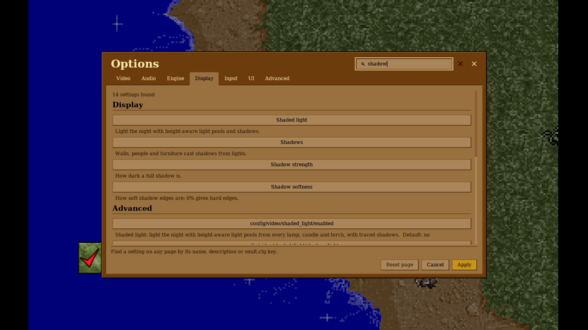
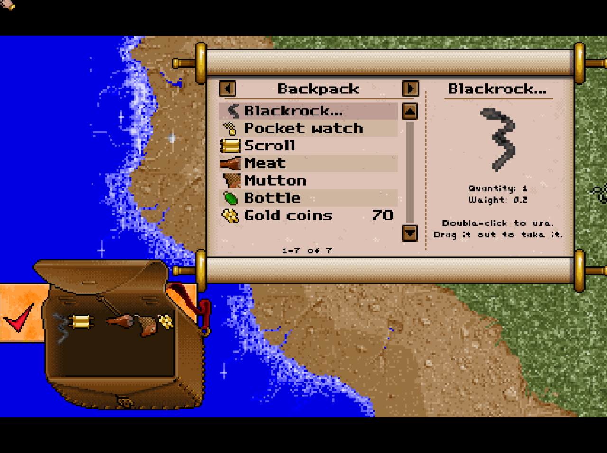
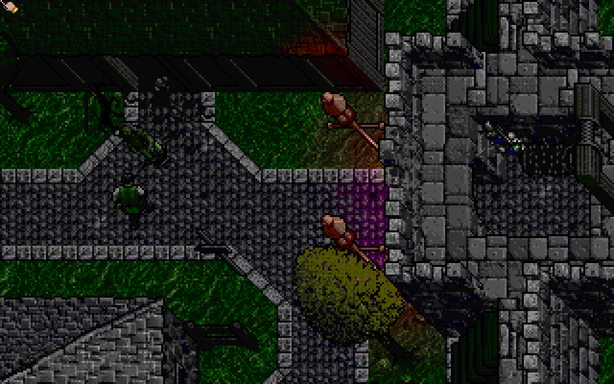

# Exult: Serpent Isle Restored Edition

**Ultima VII, the way you remember it, with an interface from this century.**

The Serpent Isle Restored Edition is a fork of [Exult](https://github.com/exult/exult), the engine that runs Ultima VII: The Black Gate and Ultima VII Part Two: Serpent Isle on modern computers. It plays both games, with Forge of Virtue and The Silver Seed, exactly as stock Exult does, and adds a modern interface, lighting and quality-of-life fixes. Everything new can be switched off: choose the Classic style and it looks and plays like Exult always has.

### [⬇ Download for Windows or Mac](https://github.com/si-restoration/exult-sir/releases)

Free and open source (GPL). You need your own copy of the games; the GOG *Ultima 7 Complete* works.

---

## What's new

**Readable conversations.** In the Ultima or Modern style, talking to someone opens a clear panel with both portraits, the speaker's name, larger text and proper answer buttons. Missed a line? Page Up scrolls back through everything said.

**Three looks.** Classic (exactly as before), Ultima (parchment and gold) or Modern, for the game menu, Options, the Journey Log, the cheat window and conversations. Options has a search box: type "music" and go straight to the setting.

**Containers as a list** (optional). A tidy, scrollable list of what's in a bag, with quantities, weight and a preview, beside the original picture. Finding one key in a crowded pack takes seconds.

**Key bindings editor.** Remap any key from the Input tab of Options. No text files.

**Shaded light** (work in progress, optional). Torches, lamps, candles and spells cast pools of light and shadows, so night feels like night. Weather lighting is off by default and can be turned on in Advanced.

**Troubleshooting** (with cheats on). Find a lost item anywhere you have been, browse NPCs and flags, and check a game for stuck quest states.

**Fixes.** Weather is saved with your game, play time is recorded in saves, and several crashes are fixed.

## Get started

1. **Download** the zip for your system from the [releases page](https://github.com/si-restoration/exult-sir/releases).
2. **Windows:** unzip it into Documents (not Program Files), copy Black Gate into its `blackgate` folder and Serpent Isle into `serpentisle`, and run `Exult.exe`. It's portable: settings and saves stay in that folder.
3. **Mac (Apple Silicon):** drag *Exult SIR Edition* to Applications and put your games in `/Library/Application Support/Exult/blackgate` and `.../serpentisle`. The first time, allow it in System Settings → Privacy & Security → Open Anyway.
4. **In the game,** press Esc and click **Menu style: Classic** to switch to Ultima or Modern.

Full setup, sound and music, and mods: **[README-SIR-EDITION.md](README-SIR-EDITION.md)**.

## Serpent Isle Restored

This edition is the companion to **Serpent Isle Restored**, a fan restoration of Serpent Isle's cut and unfinished story, currently in private testing. The mod also runs on stock Exult 1.12.1; the edition is the nicer way to play it.

## About this fork

- It tracks Exult's `master` and keeps its changes on the `sir-edition` branch. The changes are offered to the Exult project as pull requests; this edition exists so players can use them now. **It is not an official Exult release**; for stock Exult, see [exult/exult](https://github.com/exult/exult) and [exult.info](https://exult.info).
- Built for Windows (64-bit) and macOS (Apple Silicon). Linux, Steam Deck and iPad builds are not made yet.
- Bugs and ideas: [open an issue](https://github.com/si-restoration/exult-sir/issues).
- Building from source: Exult's own instructions apply ([INSTALL](INSTALL), [README.windows](README.windows), [README.macOS](README.macOS)); the release workflow is `.github/workflows/sir-edition-release.yml`.

## Credits and licence

Exult is by the Exult team (see [AUTHORS](AUTHORS)), and this edition is built on their work. Edition changes by Fuku Dragon. GPL version 2 or later, like Exult. Ultima is a trademark of Electronic Arts; this project is not affiliated with or endorsed by Electronic Arts or Origin Systems, and no game files are included.
